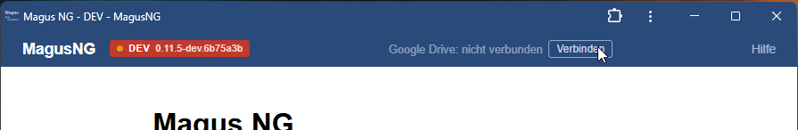
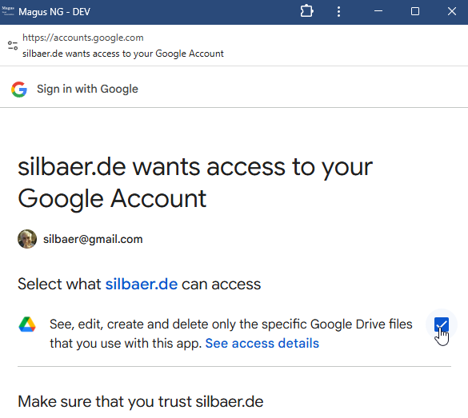

# Hilfe & FAQ

> [!WARNING] Warnung
> Dieser Text wurde per KI erzeugt und kann Fehler enthalten. Alle Angaben ohne Gewähr.

## Inhaltsverzeichnis

- [Wie funktioniert die App?](#wie-funktioniert-die-app)
- [Wie erstelle ich einen Charakter?](#wie-erstelle-ich-einen-charakter)
- [Wie steigere ich Fertigkeiten?](#wie-steigere-ich-fertigkeiten)
- [Wie verwalte ich Regelwerke?](#wie-verwalte-ich-regelwerke)
- [Wie kann ich meine Daten sichern?](#wie-kann-ich-meine-daten-sichern)
- [Lizenz und Quellcode](#lizenz-und-quellcode)

---

## Wie funktioniert die App?

M5 - Chronist ist eine **Offline-first PWA** – sie läuft komplett im Browser, ohne Server.

- Alle Daten werden lokal in deinem Browser gespeichert (IndexedDB).
- Du kannst die App auf deinem Rechner installieren und dann auch **offline** nutzen.
- Es gibt keinen Login, keine Cloud-Synchronisation (außer optionalem Google Drive Export).
- Unterstützt werden Chromium-Browser (Chrome, Edge, Opera). Firefox und Safari haben noch keine vollständige Unterstützung für die Dateisystem-API.

Zurück zum [Inhaltsverzeichnis](#inhaltsverzeichnis)

---

## Wie erstelle ich einen Charakter?

1. Klicke oben in der Navigation auf **+ Neuer Charakter**.
2. Wähle Rasse, Typ und gib einen Namen ein.
3. Trage die Eigenschaftswerte (St, Gs, Gw, …) sowie Erfahrung und Gold ein.
4. Füge Fertigkeiten und ggf. Zaubersprüche hinzu.
5. Klicke auf **Charakter erstellen**.

Dein Charakter wird automatisch gespeichert und erscheint auf der Startseite.

> [!TIP]
> Die genauen Eigenschaften, Fertigkeiten und Kosten richten sich nach den geladenen Regelwerken. Lade zuerst die passenden Regeln, bevor du einen Charakter erstellst.

Zurück zum [Inhaltsverzeichnis](#inhaltsverzeichnis)

---

## Wie steigere ich Fertigkeiten?

1. Öffne den Charakter und klicke auf **Steigern**.
2. Wähle eine bekannte Fertigkeit und klicke auf **Steigern**, um den Fertigkeitswert (FW) zu erhöhen.
3. Um eine neue Fertigkeit zu lernen, wähle sie aus der Liste **Neue Fertigkeit lernen**.
4. Die Kosten werden in EP und GS angezeigt, bevor du bestätigst.
5. Nach dem Bestätigen wird der Charakter aktualisiert.

> [!WARNING] Warnung
> **Zu beachten:**
> - Manche Fertigkeiten sind Grad-beschränkt – sie können nicht über einen bestimmten FW gesteigert werden.
> - Waffenfertigkeiten benötigen eine Spezialisierung (z. B. „Schwert“ oder „Axt“).
> - Du kannst EP auch gegen Gold ersetzen, falls nicht genug EP vorhanden sind.

> [!TIP] Ausbildung als Belohnung
> Bietet ein Auftraggeber als Belohnung kostenlose Ausbildung durch einen Lehrmeister an, stelle die **Kostenart** oben rechts (neben „EP verfügbar“) auf **Belohnung**. Alle angezeigten Kosten werden dann so berechnet:
> - **Fertigkeit lernen:** volle EP, kein Gold.
> - **Fertigkeit steigern** und **Zauber lernen:** halbe EP (aufgerundet), kein Gold.
> - Praxispunkte (PP) werden wie gewohnt zuerst abgezogen, danach wird halbiert.
> - EP können in diesem Modus nicht durch Gold ersetzt werden.
>
> Die Einstellung gilt für die Seiten **Steigern** und **Zauber** gleichermaßen. Im Bestätigungsdialog kannst du die Kostenart für die einzelne Aktion noch einmal umstellen.

Zurück zum [Inhaltsverzeichnis](#inhaltsverzeichnis)

---

## Wie verwalte ich Regelwerke?

Unter **Regeln** kannst du Regelwerke importieren, aktivieren/deaktivieren und priorisieren.

1. Klicke in der Navigation auf **Regeln**.
2. Importiere eine Regelwerk-Datei (JSON-Format) über den Button **Regeldateien importieren**.
3. Aktive Regeln werden zur Berechnung von Kosten und Werten herangezogen.
4. Über **Priorität ändern** kannst du die Reihenfolge festlegen – weiter oben = höhere Priorität.
5. Bei Konflikten gewinnt: Hausregel → Kernregel → sonstige (erster Treffer pro Feld).

Regelwerke kannst du auch aus Google Drive importieren oder exportieren.

Zurück zum [Inhaltsverzeichnis](#inhaltsverzeichnis)

---

## Wie kann ich meine Daten sichern?

**Charaktere exportieren:** Auf dem Charakterbogen klicke auf **Auf Festplatte exportieren**. Die Datei wird als JSON heruntergeladen.

**Charaktere importieren:** Auf der Startseite klicke auf **Charakter von Festplatte importieren** und wähle die JSON-Datei aus.

**Regelwerke sichern:** Unter **Regeln** kannst du Regeldateien exportieren (Google Drive) oder lokal speichern.

**Google Drive:** Du kannst Charaktere und Regeln mit Google Drive synchronisieren.

1. Klicke in der Titelleiste auf das Google Drive Symbol, um dich zu verbinden.
   
2. Es öffnet sich ein Dialog – gewähre der App die erforderlichen Zugriffsrechte.
   
3. Nach erfolgreicher Verbindung kannst du über die Export/Import-Buttons deine Daten mit Google Drive synchronisieren.

> [!WARNING] Zugriffsrechte
> Du musst der App die Berechtigung erteilen, auf dein Google Drive zuzugreifen. Ohne diese Bestätigung kann keine Synchronisation stattfinden.

> [!TIP]
> Neben dem Export einzelner Charaktere kannst du auch ein **vollständiges Backup** aller Daten erstellen.

**Backup erstellen:** Scrolle auf der Startseite nach unten zum Bereich **Backup**.

- **Download Backup** — Lädt alle Charaktere und Regelwerke als ZIP-Datei herunter (`M5-Chronist_V<Version>_backup_YYYY-MM-DD.zip`).
- **Backup to Drive** — Lädt dasselbe Backup in dein Google Drive hoch (erfordert Verbindung).

**Backup wiederherstellen:** Klicke auf **Restore Backup** oder **Restore from Drive**, um eine zuvor erstellte ZIP-Datei auszuwählen.

- Bestehende Charaktere können überschrieben, einzeln abgefragt oder übersprungen werden.
- Alle Regelwerke werden mit ihren Prioritäten und Aktivierungsstatus wiederhergestellt.

Zurück zum [Inhaltsverzeichnis](#inhaltsverzeichnis)

---

## Lizenz und Quellcode

M5 - Chronist ist freie Software unter der **GNU General Public License v3.0 (GPL-3.0)**. Du darfst die App nutzen, weitergeben und verändern, solange abgeleitete Versionen ebenfalls unter der GPL-3.0 stehen.

- **Quellcode:** [github.com/reigra/M5-Chronist](https://github.com/reigra/M5-Chronist)
- **Herkunft:** M5 - Chronist ist ein Fork von **MagusNG** ([gitlab.com/silbaer/magusng-pwa](https://gitlab.com/silbaer/magusng-pwa)) und wird seit November 2026 eigenständig weiterentwickelt.
- **LaTeX-Charakterbogen:** Die Dokumentklasse `m5figur-chronist` ist abgeleitet von [m5figur-mv](https://github.com/vaeth/m5figur-mv) von Martin Väth und steht unter der LaTeX Project Public License (LPPL 1.3c).

Diese Software ist ein reines Fanprojekt. Die Rechte an Midgard und dem Midgard-Regelwerk liegen beim Verlag für F&SF-Spiele GbR, Stelzenberg.

Zurück zum [Inhaltsverzeichnis](#inhaltsverzeichnis)
